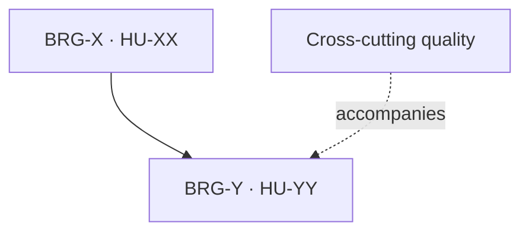

# TEMPLATE — Phase document

> This project runs phases (P0–P7), not fixed sprints. The kit calls this file `PLANTILLA-SPRINT.md`; here it is the template for one phase document.

# Phase N — <phase topic>

<!-- RELLENAR: copy to sprints/phase-NN.md when planning the phase. It is the planning and handoff document of the phase; GitHub Issues rules over status, checklist and acceptance criteria. -->

**Status:** baseline approved and reconciled with GitHub Issues on YYYY-MM-DD.
**Window:** YYYY-MM-DD to YYYY-MM-DD. **Release:** RN — <name>.
**Functional selection:** `BRG-…` (NN SP). **Cross-cutting reserve:** N equivalent SP for …
**Tasks:** `BRG-…`
**Format:** [fields and rules](../backlog-format.md) · catalog in [backlog.md](../backlog.md) · sequence in [roadmap.md](../roadmap.md).

## Goal

<!-- One paragraph: what the producer/user demonstrates in staging at the close, and what the phase leaves in parallel (decisions, infrastructure, evidence). Satisfied preconditions from earlier phases are stated here. -->

## Capacity and commitment

| Type                  | Scope | Capacity |
| --------------------- | ----- | -------: |
| Functional stories    |       |    NN SP |
| Cross-cutting quality |       | N equivalent SP |
| Tasks without SP      |       | Use the same phase capacity |
| **Total target**      |       | **NN equivalent SP** |

Tasks are not artificially converted to SP. If their real effort threatens the goal, record the consumption and escalate capacity or external wait.

## Phase records

| Key | Local ID | Type | SP | Title | Delivery dependencies |
| --- | -------- | ---- | -: | ----- | --------------------- |
|     |          |      |    |       |                       |

## Execution sequence

Recommended order:

1. …

## Ready conditions

A Story enters the cycle when:

- its acceptance criteria are current in GitHub Issues;
- it does not depend on an OPEN ADR point;
- the ERD slice it needs is approved;
- it is outside the vetoes in force in `CLAUDE.md` §5;
- the spec is written and approved before the tests (C1).

## Functional breakdown

Acceptance criteria are not copied here: GitHub Issues is their source of truth. The checkboxes prepare execution and are reconciled with each ticket's Description before starting.

### BRG-X / brg-XX — HU-XX <title>

Phase scope: <!-- what is in and what is excluded, with the ticket that covers it -->.

- [ ] `brg-XX.01` Spec site. Done when: … Internal order: …
- [ ] `brg-XX.02` Tests site in red. Done when: …
- [ ] `brg-XX.03` Code site until green. Done when: …
- [ ] `brg-XX.04` Review site. Done when: …
- [ ] `brg-XX.NN` Integration and close. Done when: …

## Tasks and cross-cutting line

### BRG-Y / brg-YY — <task>

- [ ] …

## Control gates

### Start

- Phase and goal created in GitHub Issues.
- Tickets assigned or linked to the phase.
- Preconditions from earlier phases verified.

### Mid-phase

- <!-- what must be integrated or decided by the middle -->
- The cross-cutting reserve has evidence; it was not absorbed informally.

### Close

- The selected Stories meet the Definition of Done.
- Tasks have evidence or an external blocker with an owner and a date.
- No critical defects remain open within the phase scope.

## Phase Definition of Done

A Story is Done when: specs approved, tests seen red and then green, C3 demonstrated, review with no open findings, PR merged into `develop`, CI green, applicable AC and RNF verified, documentation without drift and handoff updated.

The phase can close by calendar with pending work, but the goal is not declared met and no SP are counted if any of those conditions is missing.

## Active risks

| Risk | Signal | Response |
| ---- | ------ | -------- |
|      |        |          |

## GitHub Issues sync executed

<!-- Dated record of each change applied to the board (phase created, tickets moved, dependencies linked). If a session could not write to the board, note it here and in the handoff as pending on the human side. -->

- [ ] …
