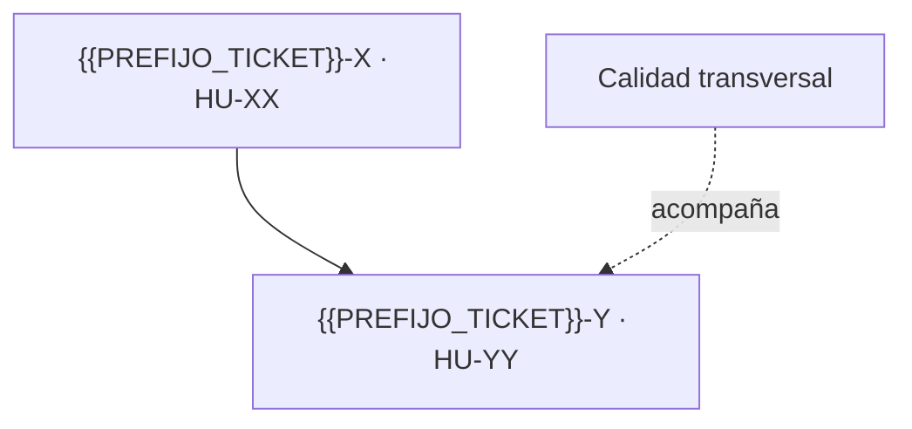

# Sprint N — <tema del sprint>

<!-- RELLENAR: copia a sprints/sprint-NN.md al planificar el sprint. Es el documento de planificación y de handoff del sprint; {{TRACKER}} manda sobre estado, checklist y criterios de aceptación. -->

**Estado:** baseline aprobada y reconciliada con {{TRACKER}} el AAAA-MM-DD.
**Ventana:** AAAA-MM-DD a AAAA-MM-DD. **Release:** RN — <nombre>.
**Selección funcional:** `{{PREFIJO_TICKET}}-…` (NN SP). **Reserva transversal:** N SP equivalentes para …
**Tasks:** `{{PREFIJO_TICKET}}-…`
**Formato:** [campos y reglas](../backlog-format.md) · catálogo en [backlog.md](../backlog.md) · secuencia en [roadmap.md](../roadmap.md).

## Objetivo

<!-- Un párrafo: qué demuestra el productor/usuario en staging al cerrar, y qué deja el sprint en paralelo (decisiones, infraestructura, evidencia). Las precondiciones satisfechas de sprints anteriores se dicen aquí. -->

## Capacidad y compromiso

| Tipo                  | Alcance | Capacidad |
| --------------------- | ------- | --------: |
| Historias funcionales |         |     NN SP |
| Calidad transversal   |         | N SP equivalentes |
| Tasks sin SP          |         | Consumen la misma capacidad del sprint |
| **Objetivo total**    |         | **NN SP equivalentes** |

Las Tasks no se convierten artificialmente a SP. Si su esfuerzo real amenaza el objetivo, se registra el consumo y se escala capacidad o espera externa.

## Registros del sprint

| Clave | ID local | Tipo | SP | Título | Dependencias de entrega |
| ----- | -------- | ---- | -: | ------ | ----------------------- |
|       |          |      |    |        |                         |

## Secuencia de ejecución

Orden recomendado:

1. …

## Condiciones de Ready

Una Story entra al ciclo cuando:

- sus criterios de aceptación están vigentes en {{TRACKER}};
- no depende de un punto ABIERTO del ADR;
- el slice del ERD que necesita está aprobado;
- está fuera de los vetos vigentes de `CLAUDE.md` §5;
- la spec se escribe y se aprueba antes de los tests (C1).

## Desglose funcional

Los criterios de aceptación no se copian aquí: {{TRACKER}} es su fuente de verdad. Las casillas preparan la ejecución y se reconcilian con la Description de cada ticket antes de empezar.

### {{PREFIJO_TICKET}}-X / {{PREFIJO_LOCAL}}-XX — HU-XX <título>

Alcance del sprint: <!-- qué entra y qué se excluye, con el ticket que lo cubre -->.

- [ ] `{{PREFIJO_LOCAL}}-XX.01` Spec {{CAPA}}. Hecho cuando: … Orden interno: …
- [ ] `{{PREFIJO_LOCAL}}-XX.02` Tests {{CAPA}} en rojo. Hecho cuando: …
- [ ] `{{PREFIJO_LOCAL}}-XX.03` Código {{CAPA}} hasta verde. Hecho cuando: …
- [ ] `{{PREFIJO_LOCAL}}-XX.04` Review {{CAPA}}. Hecho cuando: …
- [ ] `{{PREFIJO_LOCAL}}-XX.NN` Integración y cierre. Hecho cuando: …

## Tasks y línea transversal

### {{PREFIJO_TICKET}}-Y / {{PREFIJO_LOCAL}}-YY — <task>

- [ ] …

## Gates de control

### Inicio

- Sprint y objetivo creados en {{TRACKER}}.
- Tickets asignados o relacionados con el sprint.
- Precondiciones de sprints anteriores verificadas.

### Mitad del sprint

- <!-- qué debe estar integrado o decidido a mitad -->
- La reserva transversal tiene evidencia; no se absorbió de forma informal.

### Cierre

- Las Story seleccionadas cumplen la Definition of Done.
- Las Tasks tienen evidencia o un bloqueo externo con responsable y fecha.
- No quedan defectos críticos abiertos del alcance del sprint.

## Definition of Done del sprint

Una Story está Done cuando: specs aprobadas, tests vistos en rojo y luego en verde, C3 demostrada, review sin hallazgos abiertos, PR integrada en `{{RAMA_INTEGRACION}}`, CI en verde, AC y RNF aplicables verificados, documentación sin drift y handoff actualizado.

El sprint puede cerrar por calendario con trabajo pendiente, pero el objetivo no se declara cumplido ni se contabilizan SP si falta cualquiera de esas condiciones.

## Riesgos activos

| Riesgo | Señal | Respuesta |
| ------ | ----- | --------- |
|        |       |           |

## Sincronización con {{TRACKER}} ejecutada

<!-- Registro fechado de cada cambio aplicado al tablero (sprint creado, tickets movidos, dependencias enlazadas). Si una sesión no pudo escribir en el tablero, se anota aquí y en el handoff como pendiente humano. -->

- [ ] …
