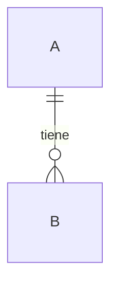

# Modelo de datos — {{PROYECTO}}

<!-- RELLENAR: copia a docs/erd/modelo-completo.md. Si el diseño se cierra por partes, cada sprint puede tener su delta (modelo-sprint-N.md) con su propia sección de aprobación; este documento resume esos deltas y manda sobre las entidades que aún no se han materializado.
Borra todo el directorio erd/ si el repo no tiene persistencia propia (p. ej. solo-frontend contra una API ajena). -->

> **{{TRACKER}}:** `{{PREFIJO_TICKET}}-XX`
> **Base:** <!-- documentos de slice previos, si existen -->
> **Estado:** borrador · aprobado por el humano el AAAA-MM-DD

## 1. Alcance y precedencia

Este documento fija el **diseño objetivo** de las entidades del sistema: `…`. Aprobarlo cierra el ERD (ADR, bloque 6, «Estado del ERD»).

Aprobar el diseño **no autoriza a migrar**. Cada tabla se crea en la historia que la consume, con su spec aprobada y sus tests en rojo (§7).

Precedencia: <!-- qué documento manda sobre qué entidad. Cuando una historia materialice una entidad, su spec puede ajustar detalles, pero primero se actualiza este documento en la misma sesión. -->

Fuera del alcance (sin respaldo en RF): …

## 2. Invariantes globales

Valen para todas las tablas salvo que la entidad diga otra cosa.

<!-- Ejemplos de invariantes que suelen merecer fila: tipo de PK; índice en cada FK; política de ON DELETE; zona horaria de los instantes; qué tablas tienen borrado lógico; cómo se guardan los enums; únicos parciales que ignoran borrados; no guardar datos derivados; convención de nombres. Cada una con su origen en el ADR. -->

| #   | Invariante | Origen |
| --- | ---------- | ------ |
| I1  |            | Dx.y   |

## 3. Entidades

### 3.1 `<tabla>`

**Propósito.** RF-0X: HU-XX (…). Sprint objetivo: SN.

**Diccionario.**

| Columna | Tipo | Nulabilidad | Restricciones e índices | Propósito |
| ------- | ---- | ----------- | ----------------------- | --------- |
| `id`    |      | `NOT NULL`  | PK                      |           |

**Relaciones.** `a` 1 — 0..N `b`.

**Reglas de negocio que el esquema no expresa** (las aplica el servicio): …

**Autorización.** Quién lee, crea, edita y borra (insumo de la matriz de permisos del ADR, 8.1).

## 4. Diagrama completo

## 5. Trazabilidad RF/HU → entidad

| RF | HU ({{TRACKER}}) | Entidades | ADR |
| -- | ---------------- | --------- | --- |
|    |                  |           |     |

## 6. Inventario de restricciones e índices

| Tabla | Índices de FK | Únicos de negocio | `CHECK` / exclusión |
| ----- | ------------- | ----------------- | ------------------- |
|       |               |                   |                     |

Contención: no se añaden más índices que los anteriores hasta que una medición de rendimiento los justifique.

## 7. Materialización por sprint

| Tabla | Migra en (ticket, sprint) | Estado |
| ----- | ------------------------- | ------ |
|       |                           | Diseño de este documento |

## 8. Verificación del diseño

<!-- Cómo se comprobó que el DDL compila y que las restricciones rechazan y aceptan lo esperado SIN dejar rastro (p. ej. ejecutarlo dentro de BEGIN … ROLLBACK contra el motor real). Lista los rechazos y las aceptaciones probados. -->

## 9. Aprobación

- **Propuesta:** AAAA-MM-DD.
- **Aprobado por:** <!-- persona -->, AAAA-MM-DD.

Al aprobarse, se actualizan en la misma rama: las decisiones afectadas del ADR, el «Estado del ERD», el documento del sprint y los tickets de {{TRACKER}} que dependían del diseño.
