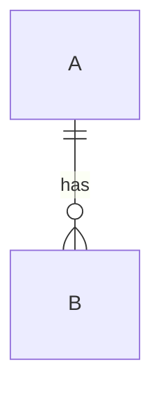

# Data model — Bridge Traducciones (website)

<!-- RELLENAR: copy to docs/erd/modelo-completo.md. If the design is closed in parts, each phase can have its delta (modelo-fase-N.md) with its own approval section; this document summarizes those deltas and rules over the entities not yet materialized.
Delete the whole erd/ directory if the repo has no persistence of its own. -->

> **GitHub Issues:** `BRG-XX`
> **Base:** <!-- earlier slice documents, if any -->
> **Status:** draft · approved by the human on YYYY-MM-DD

## 1. Scope and precedence

This document fixes the **target design** of the system entities: `…`. Approving it closes the ERD (ADR, block 6, "ERD status").

Approving the design **does not authorize migrating**. Each table is created in the story that consumes it, with its spec approved and its tests in red (§7).

Precedence: <!-- which document rules over which entity. When a story materializes an entity, its spec may adjust details, but this document is updated first in the same session. -->

Out of scope (no RF behind it): …

## 2. Global invariants

They apply to every table unless the entity says otherwise.

<!-- Examples of invariants that usually deserve a row: PK type; index on every FK; ON DELETE policy; time zone of timestamps; which tables have soft delete; how enums are stored; partial uniques that ignore deleted rows; do not store derived data; naming convention. Each with its origin in the ADR. -->

| #   | Invariant | Origin |
| --- | --------- | ------ |
| I1  |           | Dx.y   |

## 3. Entities

### 3.1 `<table>`

**Purpose.** RF-0X: HU-XX (…). Target phase: PN.

**Dictionary.**

| Column | Type | Nullability | Constraints and indexes | Purpose |
| ------ | ---- | ----------- | ----------------------- | ------- |
| `id`   |      | `NOT NULL`  | PK                      |         |

**Relations.** `a` 1 — 0..N `b`.

**Business rules the schema does not express** (enforced by the service): …

**Authorization.** Who reads, creates, edits and deletes (input to the ADR permission matrix, 8.1).

## 4. Full diagram

## 5. Traceability RF/HU → entity

| RF | HU (GitHub Issues) | Entities | ADR |
| -- | ------------------ | -------- | --- |
|    |                    |          |     |

## 6. Inventory of constraints and indexes

| Table | FK indexes | Business uniques | `CHECK` / exclusion |
| ----- | ---------- | ---------------- | ------------------- |
|       |            |                  |                     |

Restraint: no indexes are added beyond the ones above until a performance measurement justifies them.

## 7. Materialization by phase

| Table | Migrates in (ticket, phase) | Status |
| ----- | --------------------------- | ------ |
|       |                             | Design of this document |

## 8. Design verification

<!-- How we checked that the DDL compiles and that the constraints reject and accept what is expected WITHOUT leaving a trace (e.g. run it inside BEGIN … ROLLBACK against the real engine). List the rejections and acceptances tested. -->

## 9. Approval

- **Proposed:** YYYY-MM-DD.
- **Approved by:** <!-- person -->, YYYY-MM-DD.

On approval, the following are updated in the same branch: the affected ADR decisions, the "ERD status", the phase document and the GitHub Issues tickets that depended on the design.
