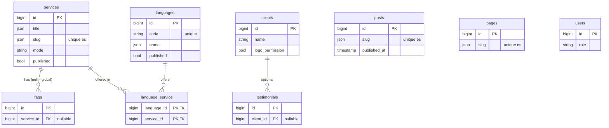

# Data model, content slice — Bridge Traducciones (website)

> **GitHub Issues:** `BRG-45` (brg-35)
> **Base:** none (first slice). The Settings and Lead slice (brg-36, `BRG-46`) follows in its own document.
> **Status:** **approved by the owner 2026-10-19** (Q1–Q4 as recommended)

## 1. Scope and precedence

This document fixes the target design of the content entities: `services`, `languages`, `language_service`, `faqs`, `posts`, `clients`, `testimonials`, `pages`, and the `role` column on `users`. Approving it closes ADR 6.3 (index strategy) **for this slice** and moves "ERD status" to partial.

Approving the design **does not authorize migrating**. brg-35 then gets its spec (C1) and red tests, as usual.

Precedence: this document owns the columns and constraints of these tables (ADR D4.1). It replaces the draft field lists in `docs/ARCHITECTURE.md` §2 for these models; that section gets a pointer here in the same PR. Names follow ADR D6.2 and `docs/nomenclatura.md`.

Out of scope (no RF behind it): post authors, blog categories and tags (D3.9), testimonial ordering, image variants (D3.9), soft deletes (I6).

## 2. Global invariants

| # | Invariant | Origin |
| --- | --- | --- |
| I1 | PK `id` auto-increment unsigned `bigint`; FKs via `foreignId()->constrained()`, which also indexes them. | D3.5 |
| I2 | Every user-facing text column (titles, bodies, slugs, SEO, labels) is `json`, translatable through `spatie/laravel-translatable`. Only `es` is filled at launch. Proper nouns (company and person names) and codes are plain `string`. | D3.6 |
| I3 | Public slugs are unique per locale, enforced in MySQL by a **functional unique index** on the `es` value: `UNIQUE ((CAST(slug->>'$.es' AS CHAR(255) CHARACTER SET utf8mb4)))`. A future locale adds one such index per sluggable table (see Q1). | D3.6, verified §8 |
| I4 | Enums are `string` columns with a PHP backed-enum cast (`ServiceMode`, `UserRole`). No DB `enum` type, no `CHECK`: the cast rejects unknown values on write. | `nomenclatura.md` §1 |
| I5 | Timestamps: `created_at`/`updated_at` on every entity table, stored UTC. Pivot tables have none. | D3.2 |
| I6 | No soft deletes. Public visibility is a `published` flag (or `published_at` for posts); delete is final. | KISS |
| I7 | `sort` is `unsigned int`, default 0, ascending; ties break by `id`. | — |
| I8 | Image columns store a path on the **public** disk (`string`, nullable). Lead attachments are the only private files (D7.1, brg-36). | D7.1 |
| I9 | Rich-text bodies hold HTML from the Filament editor. Sanitised on render, never trusted (`CLAUDE.md` §7.4). The schema doesn't express this. | §7.4 |

## 3. Entities

Type shorthand: `json·t` = translatable JSON (I2). All `json·t` columns are `NOT NULL` unless marked nullable. `bool` = `boolean` (`tinyint(1)`).

### 3.1 `services`

**Purpose.** RF-02 (HU-03): the two hubs, service pages, nav, footer and quote-form options. `mode` drives both the URL prefix and the visual mode (D4.1). Target phase: P2 (admin P3, pages P4).

| Column | Type | Null | Constraints and indexes | Purpose |
| --- | --- | --- | --- | --- |
| `id` | bigint unsigned | no | PK | |
| `title` | json·t | no | | Card and page title |
| `slug` | json·t | no | unique on `es` (I3) | `/traduccion/{slug}` or `/interpretacion/{slug}` |
| `mode` | string | no | `ServiceMode` cast: `documento` \| `cabina` | Hub, URL prefix, visual mode |
| `summary` | json·t | yes | | ServiceCard text |
| `body` | json·t | yes | | Page body (rich text, I9) |
| `icon` | string | yes | | Lucide sprite id without `i-` (ServiceCard) |
| `image` | string | yes | | Public-disk path (I8) |
| `turnaround` | json·t | yes | | "Plazo de entrega: …"; null renders "[por confirmar]" |
| `featured` | bool | no | default false | Home selection |
| `sort` | unsigned int | no | default 0 | I7 |
| `published` | bool | no | default false | Hidden from the public site when false |
| `seo_title`, `seo_description` | json·t | yes | | Fallback: `title`, `summary` |
| `created_at`, `updated_at` | timestamp | yes | | I5 |

**Business rules the schema does not express:** `mode` is fixed in the admin once published (changing it changes the URL; a 301 is a P7 concern). The quote form's `servicio` param only accepts published Documento services (contracts, query-parameter table).

### 3.2 `languages`

**Purpose.** RF-03 (HU-04): "Idiomas que trabajamos", the LangChecker data and the quote-form language selects.

| Column | Type | Null | Constraints and indexes | Purpose |
| --- | --- | --- | --- | --- |
| `id` | bigint unsigned | no | PK | |
| `code` | string(10) | no | unique | BCP 47 / ISO 639-1 code (`es`, `en`, `pt-BR` if ever needed); the `origen`/`destino` query values |
| `name` | json·t | no | | "Inglés" |
| `featured` | bool | no | default false | Sorted first in selects (contracts) |
| `sort` | unsigned int | no | default 0 | I7 |
| `published` | bool | no | default false | `Language::published()` |
| `created_at`, `updated_at` | timestamp | yes | | I5 |

`code` replaces the draft's `iso_code`: the contracts and `languages.json` already call it `code`.

### 3.3 `language_service` (pivot)

**Purpose.** RF-03: which services each language is offered for (LangChecker's `services[]`, contracts).

| Column | Type | Null | Constraints and indexes | Purpose |
| --- | --- | --- | --- | --- |
| `language_id` | bigint unsigned | no | FK → `languages`, cascade on delete | |
| `service_id` | bigint unsigned | no | FK → `services`, cascade on delete; index | |
| | | | PK (`language_id`, `service_id`) | One row per pair |

**Relations.** `languages` N — N `services`.

### 3.4 `faqs`

**Purpose.** RF-06 (HU-05): `/preguntas-frecuentes` (global) and the FAQ block on service pages; also the `FAQPage` JSON-LD.

| Column | Type | Null | Constraints and indexes | Purpose |
| --- | --- | --- | --- | --- |
| `id` | bigint unsigned | no | PK | |
| `question` | json·t | no | | |
| `answer` | json·t | no | | Rich text (I9) |
| `service_id` | bigint unsigned | yes | FK → `services`, **cascade on delete** (Q3); index | null = global FAQ |
| `sort` | unsigned int | no | default 0 | I7 |
| `created_at`, `updated_at` | timestamp | yes | | I5 |

**Relations.** `services` 1 — 0..N `faqs`.

### 3.5 `posts`

**Purpose.** RF-04 (HU-06): `/blog` and `/blog/{slug}`, `Article` JSON-LD.

| Column | Type | Null | Constraints and indexes | Purpose |
| --- | --- | --- | --- | --- |
| `id` | bigint unsigned | no | PK | |
| `title` | json·t | no | | |
| `slug` | json·t | no | unique on `es` (I3) | |
| `excerpt` | json·t | yes | | Listing text; also the SEO description fallback |
| `body` | json·t | no | | Rich text (I9) |
| `cover` | string | yes | | Public-disk path (I8); OG image |
| `published_at` | timestamp | yes | | null = draft; a future value = scheduled. Public when `≤ now()` (UTC) |
| `seo_title`, `seo_description` | json·t | yes | | |
| `created_at`, `updated_at` | timestamp | yes | | I5 |

Listing order: `published_at` descending. Pagination is ADR 3.4 (OPEN, P4) and needs no column.

### 3.6 `clients`

**Purpose.** RF-05 (HU-07): the client-logo row of the TrustStrip and the clients block on `/nosotros`.

| Column | Type | Null | Constraints and indexes | Purpose |
| --- | --- | --- | --- | --- |
| `id` | bigint unsigned | no | PK | |
| `name` | string | no | | Proper noun, not translated (I2); the logo's `alt` |
| `logo` | string | yes | | Public-disk path (I8) |
| `url` | string | yes | | Client site |
| `sector` | json·t | yes | | "Legal", "Gobierno" |
| `logo_permission` | bool | no | default false | Logo shown publicly **only** when true (D4.1) |
| `sort` | unsigned int | no | default 0 | I7 |
| `created_at`, `updated_at` | timestamp | yes | | I5 |

### 3.7 `testimonials`

**Purpose.** RF-05 (HU-07), optional for the MVP (D4.1: "the schema is cheap"). No prototype page shows one yet.

| Column | Type | Null | Constraints and indexes | Purpose |
| --- | --- | --- | --- | --- |
| `id` | bigint unsigned | no | PK | |
| `quote` | json·t | no | | |
| `person` | string | no | | Proper noun |
| `role` | json·t | yes | | "Directora de RR. HH." |
| `company` | string | yes | | Free text, for companies that aren't a `Client` |
| `client_id` | bigint unsigned | yes | FK → `clients`, **set null on delete**; index | Optional link |
| `published` | bool | no | default false | |
| `created_at`, `updated_at` | timestamp | yes | | I5 |

**Relations.** `clients` 1 — 0..N `testimonials`.

### 3.8 `pages`

**Purpose.** HU-08: simple CMS pages (`/privacidad`, the `/nosotros` body).

| Column | Type | Null | Constraints and indexes | Purpose |
| --- | --- | --- | --- | --- |
| `id` | bigint unsigned | no | PK | |
| `title` | json·t | no | | |
| `slug` | json·t | no | unique on `es` (I3) | Lookup key for the route (`privacidad`, `nosotros`) |
| `body` | json·t | no | | Rich text (I9) |
| `seo_title`, `seo_description` | json·t | yes | | |
| `created_at`, `updated_at` | timestamp | yes | | I5 |

No `published` flag: the routes are fixed in code and a missing page returns 404.

### 3.9 `users.role` (added column)

**Purpose.** RF-08 (HU-02), ADR D4.2: `admin` / `editor` via a column and policies.

| Column | Type | Null | Constraints and indexes | Purpose |
| --- | --- | --- | --- | --- |
| `role` | string | no | default `editor`; `UserRole` cast: `admin` \| `editor` | Least privilege by default (Q4) |

Migration `add_role_to_users_table` (one intent, `nomenclatura.md` §7). Policies are P3 (HU-02).

### Authorization (input to P3 policies, D4.2)

| Table | Public read | `editor` | `admin` |
| --- | --- | --- | --- |
| services, languages, faqs, posts, clients, testimonials, pages | published rows only (`clients`: logo only with `logo_permission`) | create, edit, delete | all |
| users (`role`) | — | — | all |

## 4. Full diagram

## 5. Traceability RF/HU → entity

From `docs/backlog/backlog.md` (requirements and coverage tables).

| RF | HU (GitHub Issues) | Entities | ADR |
| --- | --- | --- | --- |
| RF-02 | HU-03 (admin), HU-11, HU-12 (pages) | services, language_service | D4.1 |
| RF-03 | HU-04, HU-19 | languages, language_service | D4.1 |
| RF-04 | HU-06, HU-14 | posts | D4.1, 3.4 |
| RF-05 | HU-07, HU-13 | clients, testimonials | D4.1, DIRECTION §10 |
| RF-06 | HU-05, HU-15 | faqs | D4.1 |
| RF-08 | HU-02 | users.role | D4.2 |
| — | HU-08 | pages | D4.1 |
| RF-14 | HU-01, HU-16 | services (nav, footer) | D3.6 |

## 6. Inventory of constraints and indexes

| Table | FK indexes | Business uniques | `CHECK` / exclusion |
| --- | --- | --- | --- |
| services | — | functional unique on `slug->>'$.es'` | — (I4) |
| languages | — | `code` | — |
| language_service | `service_id` (and the PK's leading `language_id`) | PK (`language_id`, `service_id`) | — |
| faqs | `service_id` | — | — |
| posts | — | functional unique on `slug->>'$.es'` | — |
| clients | — | — | — |
| testimonials | `client_id` | — | — |
| pages | — | functional unique on `slug->>'$.es'` | — |
| users | — | `email` (Laravel default) | — |

Restraint: no indexes beyond these (no index on `sort`, `published`, `mode`) until a measurement justifies them. Every table is expected to stay under a few hundred rows. This is ADR 6.3's answer for this slice.

## 7. Materialization by phase

| Table | Migrates in (ticket, phase) | Status |
| --- | --- | --- |
| services, languages, language_service, faqs, posts, clients, testimonials, pages, users.role | brg-35 / `BRG-45`, P2 | Design of this document |
| Factories for these models | brg-35 (the model tests need them) | Design of this document |
| `LanguageSeeder`, `DatabaseSeeder` wiring | brg-37 / `BRG-47`, P2 | Pending |

## 8. Design verification

MySQL DDL auto-commits, so instead of `BEGIN … ROLLBACK` the DDL ran in a throwaway database `erd_check` on the local `mysql:8.4` container (`bridge-mysql`), which was then dropped. Run 2026-10-19:

| # | Probe | Expected | Result |
| --- | --- | --- | --- |
| R1 | Second service with `slug.es = certificada` | rejected | `1062 Duplicate entry 'certificada' for key services_slug_es_unique` |
| R2 | Second language with `code = en` | rejected | `1062 Duplicate entry 'en'` |
| R3 | Duplicate pivot row (1,1) | rejected | `1062 Duplicate entry '1-1' for key PRIMARY` |
| R4 | Pivot row to a missing service | rejected | `1452` FK failure |
| A1 | Service with another `es` slug | accepted | ok |
| A2 | Same slug under another locale key (`en`), different `es` | accepted | ok |
| A3 | Delete a service with a FAQ and a pivot row | its FAQ and pivot rows go; the global FAQ stays | 1 FAQ left, 0 pivot rows |
| A4 | Delete a client with a testimonial | `client_id` becomes null | `NULL` |

Two findings:
- `CAST(… AS CHAR)` takes the **connection** charset unless it's set. The first run failed with `COLLATION 'utf8mb4_bin' is not valid for CHARACTER SET 'latin1'`. The index expression therefore names `CHARACTER SET utf8mb4` explicitly, and uses the table's default collation (`utf8mb4_unicode_ci`), so `Certificada` and `certificada` also collide.
- `EXPLAIN` shows Laravel's `where('slug->es', $slug)` (`json_unquote(json_extract(...))`) does **not** use the functional index (type `ALL`). The identical `CAST` expression does (`const`). At these table sizes a full scan costs nothing; the index exists for integrity, not speed. brg-35's spec records this so nobody "fixes" it with an extra column.

The script lives only in the session scratchpad. brg-35's migration tests repeat R1–R4 and A3–A4 in Pest against MySQL in CI.

## 9. Approval

**Questions for the owner (answer before approval):**

1. **Q1 — Slug uniqueness in the database (I3).** Recommended: the functional unique index, verified above. Cost: D3.6 says "adding a locale is a data task, not a migration". With this index, a new locale is a data task **plus one small index migration** per sluggable table (services, posts, pages). The alternative is validation in Filament only, with no DB guarantee. If you approve the index, D3.6 gets that clarification.
2. **Q2 — No soft deletes (I6).** `published` hides, delete is final. Fine?
3. **Q3 — Deleting a service deletes its FAQs** (cascade). The alternative is `restrict`, where the admin must move or delete the FAQs first. Setting them to null is wrong, because they would silently turn into global FAQs.
4. **Q4 — New users default to `editor`.** The first admin is set by a seeder or command in P3.

- **Proposed:** 2026-10-19, by the agent.
- **Approved by:** the owner, 2026-10-19. Q1 functional unique index (D3.6 amended), Q2 no soft deletes, Q3 cascade, Q4 default `editor`.

On approval, in this same branch: ADR 6.3 (this slice's index answer) and "ERD status"; D3.6 if Q1 is yes; `docs/ARCHITECTURE.md` §2 gets a pointer here; then brg-35's spec (`docs/specs/brg-35.md`).
