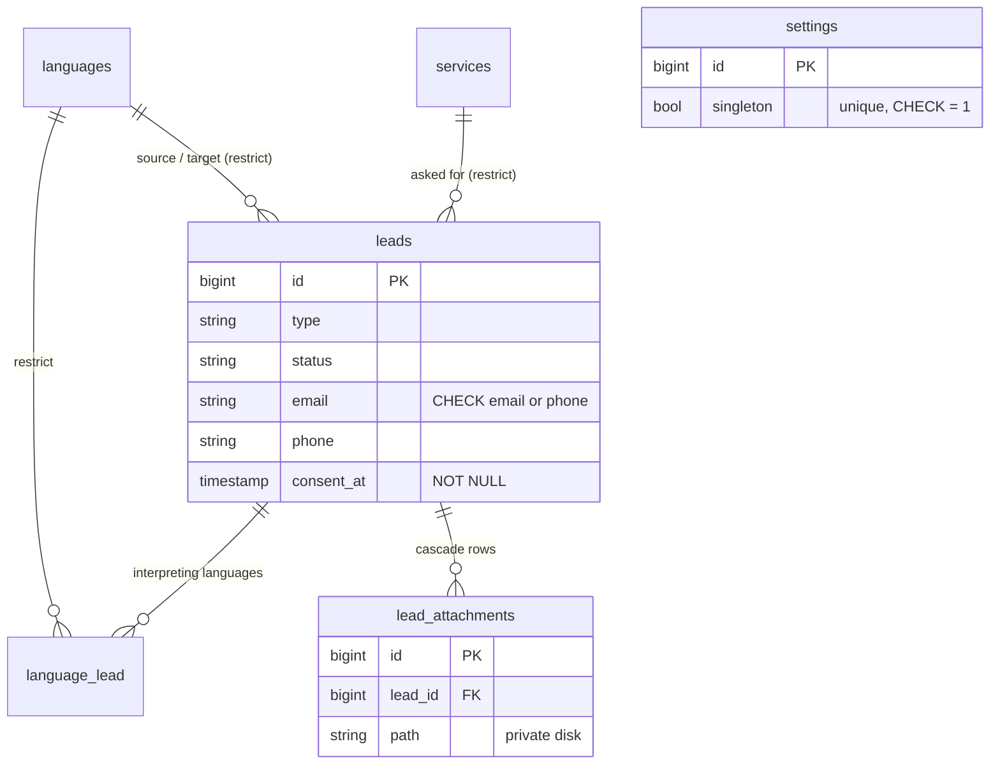

# Data model, Settings and Lead slice — Bridge Traducciones (website)

> **GitHub Issues:** `BRG-46` (brg-36)
> **Base:** [`modelo-contenido.md`](modelo-contenido.md) (its invariants I1–I9 apply here unchanged; `leads` references `services` and `languages`).
> **Status:** **approved 2026-10-19** by the agent in mode C (ADR D1.2); decisions taken alone are listed in §9.

## 1. Scope and precedence

This slice fixes `settings`, `leads`, `language_lead` and `lead_attachments`. Approving it closes ADR 6.3 for this slice and the ERD (both P2 slices exist).

Precedence: this document owns these tables' columns and constraints (ADR D4.1, 4.6). It replaces the Lead and Settings rows of `docs/ARCHITECTURE.md` §2. The form fields come from the prototype (`prototype/src/pages/cotizacion-*.html`) and ARCHITECTURE §3; what Bridge must supply comes from `docs/placeholder-register.md`.

Out of scope: the IP address (D8.5: used for rate limiting, never stored), the honeypot value, lead assignment to a user, lead history or audit trail, a separate `contacto` form table (all three forms write `leads`), retention of the lead **rows** (§9 Q-B, a question for Bridge).

## 2. Invariants added by this slice

| # | Invariant | Origin |
| --- | --- | --- |
| I10 | `settings` holds **one row**, guaranteed by the database: a `singleton` column, `NOT NULL DEFAULT 1`, `UNIQUE`, `CHECK (singleton = 1)`. A `CHECK` on `id` is impossible in MySQL (error 3818 on an auto-increment column, §8), and D3.5 keeps `id` a `bigint` auto-increment. | D4.1, 4.6 |
| I11 | Every `settings` column except `singleton` is nullable. Null means "Bridge hasn't answered", and the UI shows the register's label ("[por confirmar]"). No real value ever goes into a migration, seeder or factory. | D2.2, register |
| I12 | Lead text (name, company, message, venue, notes) is **user input, not CMS text**: plain `string`/`text`, never translatable (I2 doesn't apply). | D3.6 |
| I13 | A lead keeps what the client asked for, so the catalogue rows it references can't be deleted: `restrictOnDelete` on `service_id`, the language pair and `language_lead.language_id`. Retire a service or language by unpublishing it. | D4.1 |
| I14 | Every lead has a contact channel (`CHECK (email IS NOT NULL OR phone IS NOT NULL)`, ARCHITECTURE §3: "email **or** phone") and consent (`consent_at NOT NULL`, D8.5). | D8.5 |
| I15 | Attachment **files** live on the `private` disk (D7.1). Deleting a lead cascades its attachment **rows**; the code that deletes leads or runs the retention job deletes the files too (the database can't). | D7.1 |

## 3. Entities

Type shorthand as in the content slice (`json·t` = translatable JSON).

### 3.1 `settings`

**Purpose.** RF-07 (HU-09): contact data, claims and hero copy editable without a deploy. Read by the layout, header, footer, ContactBlock, WhatsApp button and TrustStrip (`brand/COMPONENT-CONTRACTS.md`).

| Column | Type | Null | Constraints and indexes | Purpose (register row) |
| --- | --- | --- | --- | --- |
| `id` | bigint unsigned | no | PK | |
| `singleton` | bool | no | default 1, unique, `CHECK (singleton = 1)` | I10 |
| `phone_landline` | string | yes | | #2; header strip, footer |
| `phone_mobile` | string | yes | | #2 |
| `whatsapp_number` | string | yes | | #3; `wa.me/<number>`, digits only, international format |
| `whatsapp_default_message` | json·t | yes | | #3; WhatsApp default text |
| `contact_email` | string | yes | | #4; the public email |
| `notification_email` | string | yes | | #4; where lead notifications go (P5). Never shown publicly |
| `address` | string | yes | | #5; a place name, not translated |
| `map_url` | string | yes | | #5 |
| `office_hours` | json·t | yes | | #6 |
| `socials` | json | yes | | #7; list of `{network, url}` |
| `founding_year` | unsigned smallint | yes | | #8; "Desde {year}" |
| `stats` | json·t | yes | | #9; per locale a list of `{value, label, source, verified_on}`. Shown only when documented |
| `ata_text` | json·t | yes | | #10; TrustStrip |
| `hero_hook` | json·t | yes | | #25, RF-07; null → the `lang/es` default |
| `legal_name` | string | yes | | #29; footer © line |
| `created_at`, `updated_at` | timestamp | yes | | |

**Business rules the schema does not express:** the model exposes one accessor, `Settings::current()`, which returns the row or creates the empty one; nothing else creates rows.

**Authorization.** Public read through views only. `admin` edits; `editor` doesn't (D4.2).

### 3.2 `leads`

**Purpose.** RF-09–RF-13 (HU-23–HU-28): the inbox for the three forms (contact, translation quote, interpreting quote).

| Column | Type | Null | Constraints and indexes | Purpose / form field |
| --- | --- | --- | --- | --- |
| `id` | bigint unsigned | no | PK | |
| `type` | string | no | `LeadType` cast: `contact` \| `translation` \| `interpreting` | Which form |
| `status` | string | no | default `new`; `LeadStatus` cast: `new` \| `contacted` \| `quoted` \| `won` \| `lost` | Inbox workflow |
| `name` | string | no | | `nombre` |
| `email` | string | yes | `CHECK` with `phone` (I14) | `email` |
| `phone` | string | yes | `CHECK` with `email` (I14) | `telefono` |
| `company` | string | yes | | `empresa` |
| `message` | text | yes | | `mensaje` |
| `service_id` | bigint unsigned | yes | FK → `services`, **restrict** (I13); index | `servicio`; null = "No estoy seguro" or the contact form |
| `source_language_id` | bigint unsigned | yes | FK → `languages`, restrict; index | `idioma_origen`; null = "Otro" (named in the message) |
| `target_language_id` | bigint unsigned | yes | FK → `languages`, restrict; index | `idioma_destino` |
| `needs` | json | yes | list of `LeadNeed` values | `necesita[]` on both quote forms |
| `deadline` | date | yes | | `fecha` (translation); null = no rush or not given. Plain `date`, no time zone (D3.2) |
| `event_date` | date | yes | | `fecha` (interpreting), D3.2 |
| `event_end_date` | date | yes | | `fecha_fin` |
| `venue` | string | yes | | `lugar` (city or venue) |
| `modality` | string | yes | `EventModality` cast: `in_person` \| `hybrid` \| `remote` | `modalidad` |
| `duration` | string | yes | `EventDuration` cast: `half_day` \| `full_day` \| `multi_day` | `duracion` |
| `days` | unsigned tinyint | yes | | `dias` (2–30, only with `multi_day`) |
| `language_count` | unsigned tinyint | yes | | `idiomas` (1–4, besides Spanish) |
| `attendees` | unsigned smallint | yes | | `asistentes` (20–1000) |
| `consent_at` | timestamp | **no** | (I14) | `consentimiento`; UTC |
| `notes` | text | yes | | Internal notes, admin only |
| `created_at`, `updated_at` | timestamp | yes | | The retention clock starts at `created_at` (D7.1) |

The value ranges (`dias`, `idiomas`, `asistentes`) are validation rules for P5 (ADR 4.3, OPEN). The schema only fixes the types wide enough for them. The forms' Spanish values (`presencial`, `medio`…) map to the English enum values at the form boundary (`nomenclatura.md` §1).

**Relations.** `services` 1 — 0..N `leads`; `languages` 1 — 0..N `leads` (twice, source and target); `leads` N — N `languages` through `language_lead`; `leads` 1 — 0..N `lead_attachments`.

**Authorization.** `editor` and `admin` read and update `status` and `notes`; only `admin` deletes. Nobody creates leads in the admin; only the public forms do (P5).

### 3.3 `language_lead` (pivot)

**Purpose.** The interpreting form's optional "¿Cuáles idiomas?" (`lenguas[]`).

| Column | Type | Null | Constraints and indexes | Purpose |
| --- | --- | --- | --- | --- |
| `language_id` | bigint unsigned | no | FK → `languages`, **restrict** (I13) | |
| `lead_id` | bigint unsigned | no | FK → `leads`, cascade; index | |
| | | | PK (`language_id`, `lead_id`) | |

### 3.4 `lead_attachments`

**Purpose.** D7.1: files of the translation quote form, at most 5 per lead and 20 MB each (limits in `config('leads.attachments')`, enforced by validation in P5).

| Column | Type | Null | Constraints and indexes | Purpose |
| --- | --- | --- | --- | --- |
| `id` | bigint unsigned | no | PK | |
| `lead_id` | bigint unsigned | no | FK → `leads`, cascade (I15); index | |
| `path` | string | no | | Path on the `private` disk, never public |
| `original_name` | string | no | | Shown in Filament; the download uses it |
| `mime_type` | string | no | | One of D7.1's four types |
| `size` | unsigned int | no | | Bytes |
| `created_at`, `updated_at` | timestamp | yes | | |

## 4. Diagram

## 5. Traceability RF/HU → entity

From `docs/backlog/backlog.md`.

| RF | HU | Entities | ADR |
| --- | --- | --- | --- |
| RF-07 | HU-09 | settings | D4.1, 4.6 |
| RF-09–RF-13, RF-17 | HU-23–HU-28 | leads, language_lead, lead_attachments | D7.1, D8.4, D8.5 |

## 6. Inventory of constraints and indexes

| Table | FK indexes | Business uniques | `CHECK` |
| --- | --- | --- | --- |
| settings | — | `singleton` | `singleton = 1` |
| leads | `service_id`, `source_language_id`, `target_language_id` | — | `email IS NOT NULL OR phone IS NOT NULL` |
| language_lead | `lead_id` (and the PK's leading `language_id`) | PK (`language_id`, `lead_id`) | — |
| lead_attachments | `lead_id` | — | — |

Restraint as in the content slice: no index on `status`, `type` or `created_at` until the inbox or the retention job measures slow.

## 7. Materialization by phase

| Table | Migrates in | Status |
| --- | --- | --- |
| settings, leads, language_lead, lead_attachments | brg-36 / `BRG-46`, P2 | **Migrated** 2026-10-19 (`2026_10_19_000010`–`13`) |
| Enums `LeadType`, `LeadStatus`, `LeadNeed`, `EventModality`, `EventDuration` | brg-36 | **Done** 2026-10-19 |
| Retention job, validation, forms, notifications | P5 (HU-23–HU-28) | Not in P2 |

## 8. Design verification

Throwaway database `erd_check` on the local `mysql:8.4` container, dropped afterwards. Run 2026-10-19:

| # | Probe | Expected | Result |
| --- | --- | --- | --- |
| — | `CHECK (id = 1)` on `settings` | — | **Refused by MySQL:** `3818 Check constraint 'settings_single_row' cannot refer to an auto-increment column`. Hence I10's guard column |
| A1 | First `settings` row | accepted | ok |
| R1 | Second `settings` row (default `singleton`) | rejected | `1062 Duplicate entry '1' for key settings_singleton_unique` |
| R1b | Second row with `singleton = 0` | rejected | `3819 Check constraint 'settings_single_row' is violated` |
| R2 | Lead with neither email nor phone | rejected | `3819 Check constraint 'leads_contact_channel' is violated` |
| A2 | Lead with phone only | accepted | ok |
| R3 | Lead without `consent_at` | rejected | `1364 Field 'consent_at' doesn't have a default value` (strict mode, which Laravel's MySQL connection sets) |
| R4 | Delete a service a lead uses | rejected | `1451` FK restrict |
| R5 | Delete a language a lead uses | rejected | `1451` FK restrict |
| A3 | Delete a lead | its attachment and pivot rows go | 0 and 0 left |

brg-36's tests repeat these in Pest against MySQL in CI.

## 9. Approval

- **Proposed and approved:** 2026-10-19, by the agent (mode C, ADR D1.2).

**Decisions taken by the agent** (flagged in the PR):
1. **Settings as one row with explicit columns**, not a key-value table, so Filament gets one typed form and the DB guards the single row (I10).
2. **Leads restrict deletion of the services and languages they reference** (I13). The alternative (null on delete) would silently lose what the client asked for.
3. **One `leads` table for the three forms**, with type-specific columns nullable. Three tables would triple the inbox for no gain.
4. **`hero_hook` in Settings** with a `lang/es` fallback: RF-07 requires hero copy editable without a deploy, and the register (#25) keeps the default in `lang/es`.
5. Enum values in English (`in_person`, `half_day`, …), per `nomenclatura.md` §1; added to its dictionary in the same PR.

**Question for the owner (doesn't block brg-36):**
- **Q-B — How long are lead rows kept?** D7.1 only sets the **attachment** period (90 days). The rows themselves hold names, emails and phones, and LOPDP expects a stated period. This is Bridge's call; added to the placeholder register as row #30. The schema works with any answer (it would be a scheduled job in P5, like the attachments).

On approval, in this same branch: ADR 6.3 and "ERD status" (closed), `docs/ARCHITECTURE.md` §2 pointer, `docs/nomenclatura.md` dictionary, placeholder register row #30, then the spec `docs/specs/brg-36.md`.
